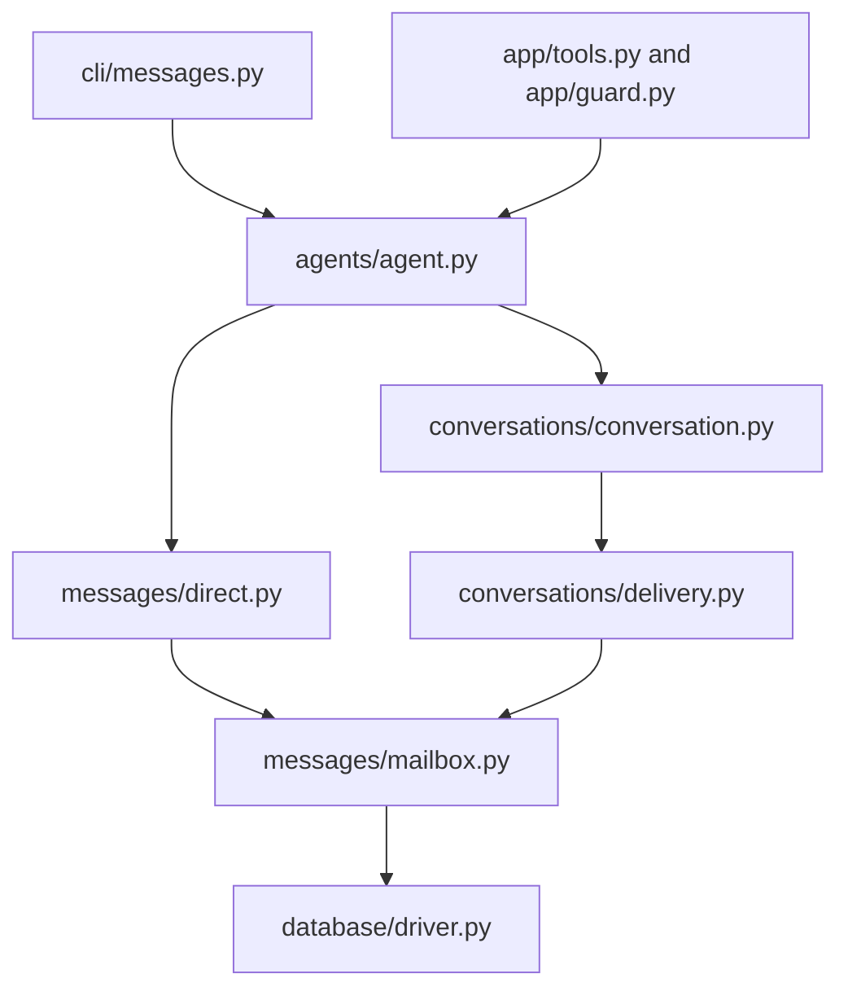

# Finding your way around Baton

Start in the package named for the feature. The CLI and MCP server translate requests into domain
operations; the domain owns behavior and uses the database connection it receives.

## Package map

```text
baton/
  app/                 MCP server, authentication guard, tool schemas and adapters
  cli/                 Command parser and commands grouped by feature
  agents/              Agent, Permissions and thread access
    secretary/         Offline attention tracking, decisions, judge and private state
  messages/            DirectMessage, Inbox, Post and mailbox delivery
  conversations/       Conversation, membership, group delivery, history and listing
  topics/              Topic containers, paths, grants and reference documents
  jobs.py              Job creation, transitions, revisions and events
  database/            Connection driver, checked files, schema and migrations
  derived/             Index generations, batches, artifacts and vectors
  config/              Configuration values, loading and validation
  integrations/        Outbound service integrations
  auth.py              Credentials, OAuth and token lifetime
  aliases.py           Guest aliases and role bindings
  board_read.py        Shared predicates for what a reader can see
  events.py            Event records, request digests and event cursors
  changes.py           Conversation change feed for indexers
  wakes.py             Wake scheduling and delivery
  search.py            Message and artifact search
  dashboard.py         Read-only browser dashboard
  seat/                Interactive human browser seat
  remote.py            MCP client used by remote CLI commands
  datadir.py           Private filesystem ownership and path checks
  errors.py            Domain errors and their public codes
```

The two top-level `secretary_decide.py` and `secretary_read.py` files are executable compatibility
entrypoints. Their implementations live in `agents/secretary/decide.py` and `agents/secretary/read.py`.

## Where to make a change

| Task | Start here | Related code |
| --- | --- | --- |
| Add or change a CLI flag | `cli/<feature>.py` | `cli/main.py` wires the command families; `cli/remote.py` forwards remote calls |
| Add or change an MCP tool | `app/tools.py`, `app/topic_tools.py`, or `app/reference_tools.py` | `app/tool_policy.py` declares registration and caller policy; `app/guard.py` enforces it |
| Change configured capabilities or guest restrictions | `agents/permissions.py` | `Permissions` owns capability checks; the MCP guard supplies authenticated context |
| Change an agent's thread access | `agents/thread.py` | Binds read, send and membership operations to the agent's role |
| Change who a message is sent as | `agents/agent.py` | Authentication resolves the role before constructing an agent |
| Change direct send/retry behavior | `messages/direct.py` | `content.py` validates content; `mailbox.py` stores recipient copies |
| Change inbox delivery or acknowledgment | `messages/inbox.py` | `mailbox.py` owns sequence positions and retiring answered wakes |
| Change the message response shape | `messages/post.py` | `rendering.py` resolves visible reply parents and bounds pages |
| Change conversation behavior | `conversations/conversation.py` | `access.py` checks permissions; `delivery.py` handles fanout and limits |
| Change conversation listing | `conversations/queries.py` | The same module loads thread summaries and participant rows |
| Change retained history | `Conversation.history()` | `conversations/retention.py` computes visibility boundaries and gaps |
| Change topic membership or lifecycle | `topics/catalog.py` | `paths.py` validates names; `grants.py` handles delegated permissions |
| Change reference documents | `topics/references.py` | `app/reference_tools.py` is the MCP adapter |
| Change job transitions | `jobs.py` | `Job.move()` owns revision checks, retries and atomic event recording |
| Change connection mechanics | `database/driver.py` | `files.py` checks private database files |
| Change the authoritative schema | `database/schema.py`, `database/migrations.py` | `database/store.py` opens and initializes the database |
| Change secretary message matching or job handoffs | `agents/secretary/rules.py` | `MessageRules` interprets messages; `job_disposition` follows job actors |
| Change expectation lifecycle or evidence limits | `agents/secretary/expectations.py` | `Expectations` opens, records and closes requests for one principal |
| Change secretary scan or replay | `agents/secretary/tracking.py` | `sources.py` reads visible records; `store.py` owns the private schema |
| Change wake/hold decisions | `agents/secretary/decide.py` | `policy.py` validates configuration; `judge.py` handles optional external judgments |
| Change brief or digest text | `agents/secretary/digest.py` | Rendering checks visibility and returns the position covered by the byte bound |
| Change secretary read output | `agents/secretary/read.py` | It reads authoritative data without advancing delivery cursors |

## Follow one message



For `baton message --to worker`, `cli/messages.py` parses and normalizes arguments. `Agent.send()`
checks the destination and derives authorship from the acting role. `DirectMessage.send()` owns validation,
retry identity, mailbox admission and the transaction. `mailbox.store_copy()` assigns the recipient's next
sequence and records its event through the shared connection. `Inbox.read()` later reads that mailbox and
advances its cursor atomically. A conversation send follows the same mailbox path for every recipient in
one transaction.

## Domain API

```python
from baton.database import connection
from baton.agents import Agent

with connection(config.db_path) as db:
    planner = Agent(db, config, "planner")
    worker = Agent(db, config, "worker")
    receipt = planner.send("Please check this", to="worker")
    page = worker.inbox.read()
```

This is trusted host-side code. MCP and browser entrypoints authenticate the caller before choosing its
role. An `Agent` represents an agent or person acting as that role; `config.Role` holds its static
settings. Constructing an agent or a conversation handle is not proof of authorization.

For a host configured with conversations and an `open` to `working` job transition:

```python
from baton.jobs import Job

with connection(config.db_path) as db:
    planner = Agent(db, config, "planner")
    worker = Agent(db, config, "worker")
    created = planner.create_thread("Release", participants=["planner", "worker"])
    planner.thread(created["conversation_id"]).send("Please check the release")
    history = worker.thread(created["conversation_id"]).read()

    created = Job.create(db, config.jobs, actor="planner", request_id="release-job-1", title="Release")
    job = Job(db, created["job_id"])
    current = job.read()
    result = job.move(config.jobs, "working", actor="worker", expected_revision=current["revision"])
```

`Agent` composes an `Inbox`, a `Permissions` value and `Thread` handles. Core roles are configured instances
of the same agent type. Permission differences are data, so ordinary role changes do not require a subclass
or mixin. `agent.permissions.allows(Capability.CREATE_CONVERSATIONS)` exposes the configured capability set.
Existing TOML role flags still load into that set; the configuration format has not changed.

The MCP guard still validates credential scopes and binding proofs. `Permissions` owns role capabilities
and guest/tool restrictions, while conversation membership and delegated topic grants are checked against
current database state inside the operation. An agent's permissions are derived on access; thread handles
do not cache membership. The secretary is an optional agent-side attention feature under `agents/secretary/`,
with its existing private state and read-only access to authoritative records.

Conversation and job handles reload mutable state for each operation. Creation returns a receipt that
says whether it created a record or replayed a previous request. The older `messages.send/read` and
`conversations.create/send/history` function APIs remain available; their behavior lives in the objects.
`conversations/api.py` contains only those adapters.

A `DirectMessage` is an independent submission: retain it, or retain its request ID, to retry safely.
Inboxes, conversations and jobs use a live connection and stay within its lifetime. Closing a connection
rolls back unfinished work. `db.transaction()` owns a write transaction; `db.snapshot()` owns a consistent
read, or borrows an existing transaction.

### Secretary workflow

The [secretary developer guide](../baton/agents/secretary/README.md) explains owed and awaited requests,
rule order, judge behavior, and the scan/decision/delivery lifecycle with examples.

`tracking.scan()` reads a page of visible events and commits its effects together with the scan position.
`MessageRules.interpret()` matches a message to outstanding requests, records its result, then opens any new
request addressed to the principal. Job events use `job_disposition()` instead. Both use an `Expectations`
ledger bound to the principal and the scan's connection; the ledger owns opening, evidence and closure limits.

When a judge is configured, `judge.Session` interprets eligible messages through the same ledger. It also
records what the word rules would have decided, rolling back that trial before applying the judgment.
`tracking.replay()` uses recorded verdicts and an in-memory ledger, so it neither calls the judge again nor
rewrites stored state.

`decide.decide()` scans within its budget, chooses wake/hold/keep, and calls `digest.render()` when text is
needed. Rendering returns both the text and the position it actually covered. The caller supplies that
position on the next call only after delivering the text; an undelivered brief is therefore retried.

## Organization rules

- Keep a feature's implementation in its package. Put CLI parsing under `cli/` and MCP schemas under `app/`.
- Keep public package entrypoints explicit. In the reorganized feature packages, `__init__.py` exposes
  names; behavior lives in named modules. Internal modules import the module that owns a helper directly.
- Name modules for their responsibility: `mailbox`, `delivery`, `retention`, `grants`, `tracking`. Avoid a
  growing `utils.py` or a second top-level file that has to be read alongside a feature's package.
- Split a module when it contains distinct responsibilities. A cohesive module such as `jobs.py` can
  remain one file; a directory is not required for every object.
- Keep behavior checks at the domain boundary and transactions around the complete operation. Moving
  code does not move authority into a transport adapter or replace a real database check with cached state.

Python import paths have moved with the implementation. CLI command names, MCP schemas and public wire
payloads stay the same. New code should import `Agent`, `Permissions` and `Capability` from `baton.agents`, message objects from
`baton.messages`, `Conversation` from `baton.conversations`, and connection APIs from `baton.database`.

SQLite is currently supported. SQLAlchemy supplies the connection boundary for the intended PostgreSQL
backend, but existing SQL, FTS5 search and writer serialization still need porting. Moving files does not
make those backend assumptions portable.
