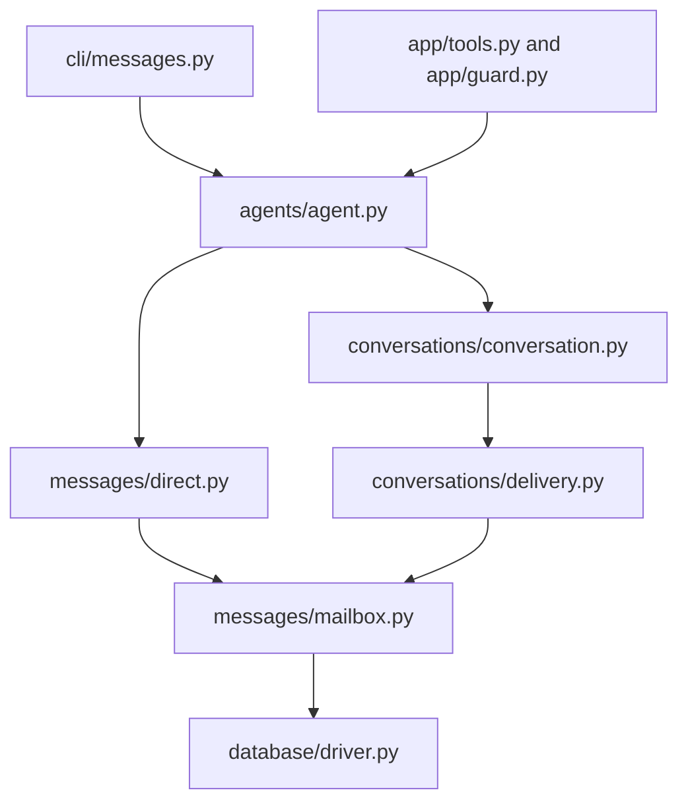

# Finding your way around Baton

Start in the package named for the feature. The CLI and MCP server translate requests into domain
operations; the domain owns behavior and uses the database connection it receives.

## Package map

```text
baton/
  app/                 MCP server, authentication guard, tool schemas and adapters
  cli/                 Command parser and commands grouped by feature
  agents/              Agent, Permissions and thread access
    secretary/         Model-driven inbox triage and summary delivery, split by responsibility
  config/              Configuration values, loading, validation, including secretary policy/config
  messages/            DirectMessage, Inbox, Post and mailbox delivery
  conversations/       Conversation, membership, group delivery, history and listing
  topics/              Topic containers, paths, grants and reference documents
  jobs.py              Job creation, transitions, revisions and events
  database/            Connection driver, checked files, schema and migrations
  derived/             Index generations, batches, artifacts and vectors
  integrations/        Outbound service integrations
  auth.py              Credentials, OAuth and token lifetime
  aliases.py           Guest aliases and role bindings
  board_read.py        Shared predicates for what a reader can see
  events.py            Event records, request digests and event cursors
  changes.py           Conversation change feed for indexers
  wakes.py             Wake scheduling and delivery
  search.py            Message and artifact search
  dashboard.py         Read-only browser dashboard
  seat/                Interactive human browser seat
  remote.py            MCP client used by remote CLI commands
  datadir.py           Private filesystem ownership and path checks
  errors.py            Domain errors and their public codes
```

The top-level `secretary_decide.py` and `secretary_read.py` modules remain compatibility wrappers, executable
with `python -m baton.secretary_decide` and `python -m baton.secretary_read`. They delegate to the canonical
CLI entrypoints `agents/secretary/attention/decide.py` and `agents/secretary/inbox/read.py`; callers should
import from those canonical modules. The separate Python API exports `Secretary`, `show`, `Policy`, and
`load_policy` from `baton.agents.secretary`.

## Where to make a change

| Task | Start here | Related code |
| --- | --- | --- |
| Add or change a CLI flag | `cli/<feature>.py` | `cli/main.py` wires the command families; `cli/remote.py` forwards remote calls |
| Add or change an MCP tool | `app/tools.py`, `app/topic_tools.py`, or `app/reference_tools.py` | `app/tool_policy.py` declares registration and caller policy; `app/guard.py` enforces it |
| Change configured capabilities or guest restrictions | `agents/permissions.py` | `Permissions` owns capability checks; the MCP guard supplies authenticated context |
| Change an agent's thread access | `agents/thread.py` | Binds read, send and membership operations to the agent's role |
| Change who a message is sent as | `agents/agent.py` | Authentication resolves the role before constructing an agent |
| Change direct send/retry behavior | `messages/direct.py` | `content.py` validates content; `mailbox.py` stores recipient copies |
| Change inbox delivery or acknowledgment | `messages/inbox.py` | `mailbox.py` owns sequence positions and retiring answered wakes |
| Change the message response shape | `messages/post.py` | `rendering.py` resolves visible reply parents and bounds pages |
| Change conversation behavior | `conversations/conversation.py` | `access.py` checks permissions; `delivery.py` handles fanout and limits |
| Change conversation listing | `conversations/queries.py` | The same module loads thread summaries and participant rows |
| Change retained history | `Conversation.history()` | `conversations/retention.py` computes visibility boundaries and gaps |
| Change topic membership or lifecycle | `topics/catalog.py` | `paths.py` validates names; `grants.py` handles delegated permissions |
| Change reference documents | `topics/references.py` | `app/reference_tools.py` is the MCP adapter |
| Change job transitions | `jobs.py` | `Job.move()` owns revision checks, retries and atomic event recording |
| Change connection mechanics | `database/driver.py` | `files.py` checks private database files |
| Change the authoritative schema | `database/schema.py`, `database/migrations.py` | `database/store.py` opens and initializes the database |
| Change secretary policy validation or installed-instance configuration | `config/secretary.py` | Owns `Policy`, `load_policy`, `fingerprint`, and `IntegrationConfig`; the Baton host TOML format is unchanged |
| Change the model's inbox context or size limits | `agents/secretary/inbox/window.py` | `inbox/read.py` and `inbox/sources.py` load visible records and source context; oversized full windows fail |
| Change wake/hold/keep assessment and callback lifecycle | `agents/secretary/attention/decide.py` | Coordinates the window, model call, cache and visibility recheck |
| Change model or independent decision-engine transport | `agents/secretary/connections/` | `connections/model.py` selects model transport; `connections/decisions.py` owns typed engine adapters; `connections/transport.py` bounds I/O |
| Change instructions or structured response shape | `agents/secretary/harness/prompt.py`, `attention/assessment.py` | Assessment validation checks decisions, summary bounds and cited source keys |
| Change bounded model/tool turns | `agents/secretary/harness/run.py`, `harness/tools.py` | `harness/prompt.py` builds ordered prompt layers; tool verdict reuse remains per assessment |
| Change private assessment cache or delivery acknowledgment | `agents/secretary/attention/state.py`, `service.py` | Acknowledged ranges merge into delivered coverage only when contiguous |
| Change durable secretary backlog or shared summary archive | `agents/secretary/attention/backlog.py`, `attention/archive.py` | Backlog owns retries and delivery IDs; `baton.db` stores append-only summaries |
| Change secretary source visibility or read output | `agents/secretary/inbox/read.py`, `inbox/sources.py` | Reads current authoritative data without advancing Baton inbox cursors |

Secretary packages are organized around assessment lifecycle (`attention`), authorized inbox context (`inbox`),
model prompting and bounded turns (`harness`), and model/decision-engine I/O (`connections`). Their package
`__init__.py` files contain docstrings only; import implementation from its canonical module, for example
`from baton.agents.secretary.harness.run import SecretaryHarness`. The root package keeps the public
`Secretary`, `show`, `Policy`, and `load_policy` API. Configuration code is centralized in `config/secretary.py`.
The Baton host TOML format is unchanged. Secretary policy version 3 is required, with explicit model, decision
engine, threshold, retry, and page settings. Private state version 1 is refused and requires a new file; version
2 remains supported. The installed integration JSON is a separate worker configuration with independent
assessment and required delivery timeouts; startup validates that the engine timeout is shorter than its assessment budget.

## Follow one message



For `baton message --to worker`, `cli/messages.py` parses and normalizes arguments. `Agent.send()`
checks the destination and derives authorship from the acting role. `DirectMessage.send()` owns validation,
retry identity, mailbox admission and the transaction. `mailbox.store_copy()` assigns the recipient's next
sequence and records its event through the shared connection. `Inbox.read()` later reads that mailbox and
advances its cursor atomically. A conversation send follows the same mailbox path for every recipient in
one transaction.

## Domain API

```python
from baton.database import connection
from baton.agents import Agent

with connection(config.db_path) as db:
    planner = Agent(db, config, "planner")
    worker = Agent(db, config, "worker")
    receipt = planner.send("Please check this", to="worker")
    page = worker.inbox.read()
```

This is trusted host-side code. MCP and browser entrypoints authenticate the caller before choosing its
role. An `Agent` represents an agent or person acting as that role; `config.Role` holds its static
settings. Constructing an agent or a conversation handle is not proof of authorization.

For a host configured with conversations and an `open` to `working` job transition:

```python
from baton.jobs import Job

with connection(config.db_path) as db:
    planner = Agent(db, config, "planner")
    worker = Agent(db, config, "worker")
    created = planner.create_thread("Release", participants=["planner", "worker"])
    planner.thread(created["conversation_id"]).send("Please check the release")
    history = worker.thread(created["conversation_id"]).read()

    created = Job.create(db, config.jobs, actor="planner", request_id="release-job-1", title="Release")
    job = Job(db, created["job_id"])
    current = job.read()
    result = job.move(config.jobs, "working", actor="worker", expected_revision=current["revision"])
```

`Agent` composes an `Inbox`, a `Permissions` value and `Thread` handles. Core roles are configured instances
of the same agent type. Permission differences are data, so ordinary role changes do not require a subclass
or mixin. `agent.permissions.allows(Capability.CREATE_CONVERSATIONS)` exposes the configured capability set.
Existing TOML role flags still load into that set; the configuration format has not changed.

The MCP guard still validates credential scopes and binding proofs. `Permissions` owns role capabilities
and guest/tool restrictions, while conversation membership and delegated topic grants are checked against
current database state inside the operation. An agent's permissions are derived on access; thread handles
do not cache membership. The secretary is an optional agent-side attention feature under `agents/secretary/`,
with its existing private state and read-only access to authoritative records; deliverable summaries are also
appended to the shared `secretary_summaries` archive.

Conversation and job handles reload mutable state for each operation. Creation returns a receipt that
says whether it created a record or replayed a previous request. The older `messages.send/read` and
`conversations.create/send/history` function APIs remain available; their behavior lives in the objects.
`conversations/api.py` contains only those adapters.

A `DirectMessage` is an independent submission: retain it, or retain its request ID, to retry safely.
Inboxes, conversations and jobs use a live connection and stay within its lifetime. Closing a connection
rolls back unfinished work. `db.transaction()` owns a write transaction; `db.snapshot()` owns a consistent
read, or borrows an existing transaction.

### Secretary workflow

The [secretary developer guide](../baton/agents/secretary/README.md) documents model setup, host delivery,
and source references. The planned principal feedback loop is described in the [roadmap](roadmap.md).

Installation binds the activation floor to the current database head. Standalone implicit decisions check due
retries first and then resume from durable scan progress; explicit `since` and `floor` request an exact replay.
One due retry takes precedence over a newer trigger; the host handles its result then calls again for the new
event. An untriggered call during failed-page backoff reports retryable unavailability. The worker reads complete bounded pages and reserves model output space for citations.
Provider outages back off in their original mode. Invalid model content/output and oversized windows count
toward `max_attempts`. Timeouts, rejected requests, and failed commands also count after another page succeeds
under the same policy since that page last failed. Saved results recover before either provider runs again. Held contiguous pages combine into
bounded digests; digest failures remain digest work and eventually yield a keep notice. Worker health is tracked
separately from page retry state. Each poll reserves one full budget for a fresh alert and one for scheduled work;
one eligible scheduled lane receives the full reserved budget per poll, with retry and digest priority alternating.

An independent decision engine evaluates each alert page. A `wake` with `wake_probability` at or above
`wake_threshold` overrides model hold, keep, or failure. JEV uses `probabilities["wake"]`, not its separate wire
`confidence`; command engines use protocol 3 with exactly `decision` and `wake_probability`. The model can call a
tool to read the already-computed verdict, without engine reasoning. Engine, model, and delivery health have
separate sanitized failure categories and warnings; model outage only becomes a notice when the engine forced a wake.
Every deliverable summary cites and accounts for each page event; parent citations are
optional. Validation checks source references, not claim truth, and instructions prohibit invented assignments
or approvals. Pending receipts retain all decision IDs, surface wakes first, and announce newly pending IDs even
while older ones await acknowledgement. Acknowledgements are idempotent and advance delivery only across
contiguous ranges. Source reads use a read-only snapshot. Writing a deliverable archive row to
`secretary_summaries` requires database write access; archive reads are available locally and through the
authenticated, role-scoped `read_secretary_summaries` MCP tool / remote CLI command.

The secretary accepts policy version 3 with explicit model, engine, thresholds, retries, and limits. Private
state version 1 is refused and requires a new file; version 2 remains supported. Harness version 4 invalidates
older assessment cache entries after the engine result and prompt changes. The top-level
`baton.secretary_decide` and `baton.secretary_read` modules are CLI wrappers run with `python -m`; they are not
the full Python API. The public Python
API exports `Secretary`, `show`, `Policy`, and `load_policy`; import implementation from canonical modules.

## Organization rules

- Keep a feature's implementation in its package. Put CLI parsing under `cli/` and MCP schemas under `app/`.
- Keep public package entrypoints explicit. In the reorganized feature packages, `__init__.py` exposes
  names; behavior lives in named modules. Internal modules import the module that owns a helper directly.
- Name modules for their responsibility: `mailbox`, `delivery`, `retention`, `grants`, `tracking`. Avoid a
  growing `utils.py` or a second top-level file that has to be read alongside a feature's package.
- Split a module when it contains distinct responsibilities. A cohesive module such as `jobs.py` can
  remain one file; a directory is not required for every object.
- Keep behavior checks at the domain boundary and transactions around the complete operation. Moving
  code does not move authority into a transport adapter or replace a real database check with cached state.

Python import paths have moved with the implementation. CLI command names, MCP schemas and public wire
payloads stay the same. New code should import `Agent`, `Permissions` and `Capability` from `baton.agents`, message objects from
`baton.messages`, `Conversation` from `baton.conversations`, and connection APIs from `baton.database`.

SQLite is currently supported. SQLAlchemy supplies the connection boundary for the intended PostgreSQL
backend, but existing SQL, FTS5 search and writer serialization still need porting. The
[PostgreSQL roadmap](roadmap.md#postgresql-backend) describes the remaining work and backend validation.
