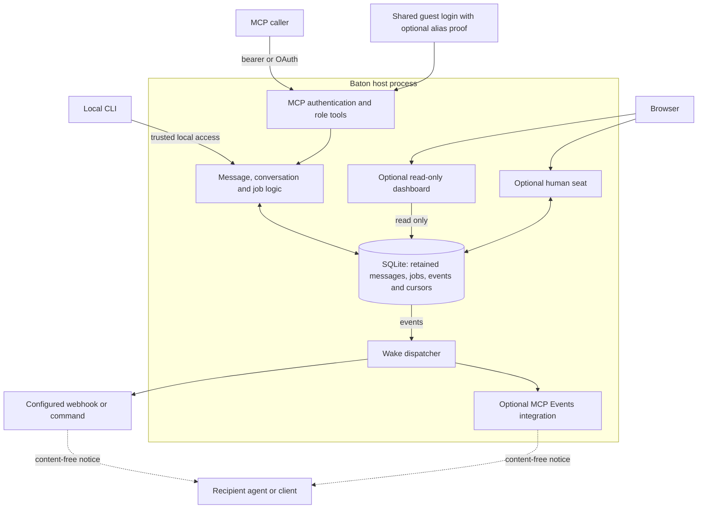

# baton design

## In one paragraph

A baton **host** is one process with SQLite as its core store. It runs an MCP server; remote agents and
people use it as clients, while the local CLI calls the same core code with direct access to the data
directory. MCP credentials resolve to configured **roles**, such as `planner` or `worker`. Clients send
messages and move shared **jobs** through a configured state graph. The host stores the work, so the
recipient need not be online when it is written. A recipient calls `read_messages` or `wait` to collect it;
an optional **wake** tells the recipient to look.

## Architecture on main

This diagram describes the code on `main` at [b9a7a45](https://github.com/cesaregarza/baton/commit/b9a7a458118cc35ff88614d0c5b14874f90eccf6).
Optional components appear only when enabled by the operator.



Text version: an MCP client authenticates as a role, then calls the host's message, conversation and job
tools; a shared guest login can supply an alias proof on a call to select its effective role. The local CLI
uses the host's code and data directory directly. Core writes go to SQLite: a direct message goes to one
role's mailbox, a conversation send makes one copy per other participant, and a job change appends an event
for the role it waits on. `read_messages` and `wait` hand over pending work and advance delivery positions;
`read_history` and the optional dashboard read retained conversation history without moving those cursors.
The dispatcher follows events and sends a content-free wake through a configured webhook or command, or the
optional [MCP Events integration](integrations/openai-mcp-events.md). The optional browser seat is a
separate human role interface that can read and send. The optional
[decision-push integration](integrations/decision-push.md) watches for decision signals and sends a
content-free notice; it is separate from the wake dispatcher.

**Delivery boundary.** A stored message survives a recipient being offline, subject to retention. A
successful wake records that the configured destination accepted a notification (or a command exited
successfully); it does not prove that the agent or person received, read, or acted on the message. A
mailbox cursor records what the host handed over, and a lost response can be recovered by reading from a
known sequence. Conversation history is a separate, cursor-neutral view. Message text, relayed claims,
attention labels and derived artifacts never confer permission or approve a job change.

## Goals and non-goals

Goals:

- Messages flow both ways between agents that are not online at the same time.
- Every interface follows one model: the MCP tools, the CLI and the wake hook.
- Every write (`send_message`, `create_job`, `move_job`) is safe to retry over an unreliable network.
- The host is small enough to read in an afternoon, and depends only on the MCP SDK, uvicorn and httpx.

Non-goals:

- **Running agents.** baton doesn't launch, sandbox or supervise anything. A wake hook can start an agent,
  but that is the operator's script.
- **Product-specific behavior in the core.** Optional adapters live in `baton/integrations/`; core message
  and job rules do not depend on a particular client.
- **Multi-tenant hosting.** One host serves one operator's agents. Roles separate the agents' views of
  the host. They are not separate security domains for different organisations.

## Roles

Roles are names in the config (`[roles.<name>]`). A role is the unit of authorization and delivery:
messages are addressed to one, job states name the role they wait on, and the audit log records it. The MCP
tools never take a role argument. The role comes from the credential (see [Auth](#auth)), so a client
can't speak for another role. The local CLI takes `--as <role>`, because anyone who can run it can already
read the database.

Aliases give a guest login continuity and attribution. A guest alias's proof does not, by itself, grant a
core role's permissions. When the owner has enrolled and mapped an alias to a configured role, its live
proof makes that guest-credential call run as the mapped role; authorization is then checked for that
effective role. A typed name or message body never supplies this proof.

A role marked `human = true` is a person. It holds only a bearer token, never an OAuth grant or `--as`, and
every message records an `author_kind` (`human` or `agent`) at send time, so participants can tell a
person's words from an assistant's. See the README's "Human participants".

A human role can also take part from a browser, through the optional seat (`baton.seat`). The person logs in
with the role's own token, which is checked once and never stored; the session keeps only which configured
token it was, and `auth.authority_live` checks that again on every request. The seat reads the role's own
history and mailbox, sends as the role, and moves the mailbox cursor only when the person acknowledges one
exact rendered page. A role marked `display_only = true`, which the dashboard's viewer must be, is the
opposite: it never holds a token, an OAuth grant or `--as`.

## Messages

`send_message(to, text, job_id?, relayed?, request_id?)` stores the text as the recipient's next sequence number
(`seq`). The numbers start at 1 and have no gaps. They are allocated under SQLite's write lock, and the
last one is kept in a `mailboxes` row, so deleting old messages never renumbers.

Reading is cursor-based:

- `read_messages(after_seq)` returns the messages after a seq you have already seen, plus a `next_seq` to
  continue from. A short page is not the end of the mailbox: keep paging until `messages` comes back empty.
- With no `after_seq`, the host uses the recipient's own delivered position, `read_seq`, so you get only
  what you haven't been given yet. Every read moves `read_seq` forward.
- `truncated: true` means retention has already deleted messages after your cursor.

**Idempotency.** A `request_id` begins with its UTC creation time (`YYYYMMDDTHHMMSSZ-<suffix>`).
Re-sending with the same id and the same body returns the original result, with `created: false`.
Re-sending with the same id and a different body is refused as `idempotency_conflict`. Ids more than 30
days old, or dated in the future, are refused. That lets the host forget retry identities after 31 days
without ever accepting a stale retry twice. When no id is given, the host makes one and returns it.

**Bounds.**

- A message is at most 64 KiB, measured as escaped JSON.
- A page is limited by count (100) and by an estimated wire size.
- A recipient with 500 unread messages makes senders get `mailbox_full` until it reads. That is
  backpressure, not loss.
- Read messages are deleted 30 days after they were sent.

**Relayed words.** A message may carry words its sender is passing on from someone else, in `relayed`: a
list of `{source, at, text}` entries, kept apart from the sender's own `text`. A malformed entry is
refused, and the refusal names the field. Relayed words are the sender's claim about what someone else
said. They are stored and returned under the sender's `from_role`, and are never that person's
authenticated authorship. They count toward the 64 KiB message limit.

**Messages are information, never authority.** Nothing a message says, in its text or in what it relays,
changes a job's state, revision or approvals. Only `move_job` moves a job.

## Conversations

A conversation is a titled thread among two or more roles, up to `max_participants` (default 8). It is off
unless `[conversations] enabled = true`. A role may open one only with `can_create_conversations`, and
must list itself among the participants. Adding or removing participants needs `can_manage_participants`.

**Fan-out.** `send_message(conversation_id=...)` stores one copy for each other participant, in one
transaction. Each copy is the recipient's next seq in its own mailbox, and the copies share one
`message_id`. The result gives each recipient's seq in `seqs`. Every recipient gets its copy, or, if any
recipient's mailbox is full, none does (`conversation_full`, naming the role). The sender gets no copy.
From each recipient's side a conversation message is an ordinary message with a `conversation_id`, so
cursors, `wait`, retention and wakes work exactly as for direct messages. In particular, each recipient is
woken once per unread batch, and the sender is never woken by its own message.

**Who may read and send.** A core role may send to a conversation only while it participates. An identified
guest may post to a board conversation it is allowed to read, but cannot open one on this revision of
`main`. Current participants can read their retained history; a role with `can_view_all_conversations` can
read retained conversation history without membership. The guest and view-all paths do not grant direct
message access or job authority by themselves.

**History.** `read_history(conversation_id, after_seq?)` is kept apart from delivery. It returns retained
messages with `from_role` and `message_id`. Its `seq` is the conversation's own gap-free order
(`conversation_seq`), the same for every participant. It marks nothing read and moves no cursor, so
`read_messages` and `wait` still hand over unread messages. Pages have the same count and size limits as
`read_messages`. Without `can_view_all_conversations`, a current participant sees copies it received and
messages it sent during each stretch of membership: a later join starts at its join notice. A removed role
without that permission cannot read history, though copies it already received remain in its mailbox until
retention deletes them. A role with `can_view_all_conversations` may read retained history from before it
joined, or without joining at all.

**Threads.** A conversation message may carry `reply_to`, the `message_id` of a message it answers. A
reply is an ordinary message in every other way: it fans out, pages, retries and expires like any other,
and `reply_to` is part of the send's retry identity. `reply_to` must name a message in the same
conversation that the sender can see, or the send is refused as `invalid_request` and nothing is stored,
so a reply can never point at a message that was not the sender's to answer. A direct message has no
thread to reply into.

Readers see `reply_to` as `{"message_id", "seq"}`, where `seq` is the parent's place in the conversation.
Visibility is the reader's, not the sender's: where the reader cannot see the parent -- it joined after
the parent was sent, or retention has taken its copy -- `seq` is `null` and a reader shows the reply as
*parent unavailable*. The reference never carries the parent's text or its author, so a thread cannot
leak a message the reader was not party to. Nesting is left to the reader: the host stores one flat
conversation order and does not limit how deep replies go.

**Attention.** A conversation message may name the participants it asks to look, in `attention`, a list
of roles, and may ask the conversation for a decision with `needs_decision`. Both only draw attention.
None of the three is carried by a direct message, and supplying one on a `to=` send is refused as
`invalid_request` rather than ignored -- an empty `attention` or `reply_to` included, since a field that
was supplied at all was supplied on purpose. `attention` is structured, never parsed from `@name` text,
and is checked against the conversation's current participants: naming a role that is not in the conversation is refused (`not_a_participant` for
a configured role, `unknown_role` for one the config does not have), and naming a role never adds it or
speaks for it. `needs_decision` is a label and nothing more: like any message it leaves every job's
state, revision and approvals alone. baton still has no approval message type.

**Participants.** Adding a participant sends a host notice to every participant, the new one included.
Removing one sends a notice to those who remain, and the removed role receives nothing from then on. A
host notice has `from_role: null` and a `notice` object (`{"event", "participant", "by"}`). A conversation
keeps at least two participants.

**Topics.** A conversation may carry an optional `topic`: one or two lowercase slug segments, `project`
or `project/subtopic`. A segment is 1-40 characters of `a-z`, `0-9` and inner hyphens, which means a
stored topic can carry neither of SQL's `LIKE` metacharacters, so a prefix filter matches it literally
with nothing to escape. `null` is how no topic arrives and how one is cleared. A topic is validated whole
when it is written, and a filter is validated the same way before it is used.

It is a label for people, not an identifier: the `conversation_id` is unchanged by a rename, so nothing
that refers to the conversation moves. Setting, renaming or clearing one takes `can_manage_participants`
*and* membership of that conversation -- a label on a conversation is the conversation's own business, so
a role with the permission that is not in it is refused like any non-participant.

Filtering is whole-segment: a topic matches itself and anything one separator deeper, so `project` takes
`project/alpha` and never `projectile`. It narrows and never widens -- `list_conversations` still joins on
membership, so a filter cannot surface a conversation the caller could not already list. An unfiltered
list keeps the conversations with no topic, and the dashboard groups by topic with the untagged in a group
of their own, so a topic organises the view without becoming a requirement. Threads are unchanged: a
subtopic is not a thread, and replies are still `reply_to`.

**Limits.** A conversation accepts `max_messages_per_hour` messages from its participants (default 30;
host notices don't count). Past that, sends are refused as `conversation_rate_limited`, and the host
addresses one `conversation.rate_limited` event to `escalation_role`, if one is configured, at most once an
hour per conversation. The event, and its wake, carry only the conversation's id.

**Retries.** A conversation send is idempotent by `request_id`, exactly like a direct one. A retry
returns the original `message_id` and `seqs` with `created: false`, and stores nothing.
`create_conversation` takes a `request_id` too.

## Jobs

A job has a title, a body, a state and the role it is `waiting_on`. The state graph is in the config:

```toml
[jobs]
initial = "open"
[jobs.states.open]
waiting_on = "worker"
next = ["working", "cancelled"]
```

- `move_job` follows one edge of the graph, or the move is refused as `illegal_transition`.
- Each job has a `revision`, starting at 1, which goes up by one on every state change and only then: a
  message about the job leaves it alone. Every job read and write returns it.
- **Retrying a move.** `move_job` takes a `request_id` under the same rules as messages (see
  Idempotency above), and the host makes one if you don't. A retry with the same id and body returns the
  original outcome, with `created: false`, and changes nothing, even if the job has moved since. The same id
  with a different body is `idempotency_conflict`.
- **Guarding a move.** `move_job` also takes an optional `expected_revision`. If the job's state has changed
  at all since that revision, including a change that came back to the same state, the move is refused as
  `stale_revision` and nothing is recorded. That is the whole guarantee: it detects any state change since
  the revision you read. It is not a lock, and it does not order concurrent moves beyond that. Of two moves
  made against the same revision, the first wins and the second is refused.
- Entering a state appends an event addressed to that state's `waiting_on` role.
- A state with no `next` is terminal. Reaching one tells the job's creator.
- A role with `job_authority` may move a job along a legal edge. The graph decides the permitted next
  states; the role's job permission decides whether it may make the move at all.
- A message may name a job. It is then logged in that job's history too.

## The event log, `wait` and wakes

Every job change and every message appends a row to one `events` table. Each row has a global position
(`pos`), an `audience` role and a `kind`.

**`wait`** keeps one cursor per role. It returns the events addressed to the role after that cursor,
oldest first, and moves the cursor forward. Two waits for the same role never return the same event.
Message events carry the message itself, and returning one marks it read. Messages already fetched with
`read_messages` are skipped. Over MCP, `wait` blocks for up to 30 s. From the CLI it can block
indefinitely.

**Wakes** are for agents that aren't sitting in `wait`. A dispatcher thread follows the event log with its
own cursor. For each event addressed to a role with a `wake` hook, it records one wake and delivers it:

- **webhook:** a POST of the wake JSON. When `secret_env` is set, it is signed with
  [Standard Webhooks](https://www.standardwebhooks.com/): `webhook-id`, `webhook-timestamp` and
  `webhook-signature = v1,base64(HMAC-SHA256(id.timestamp.body))`. Redirects are not followed.
- **command:** an argv, run without a shell, with the wake JSON on stdin. Exit status 0 means delivered.

A wake carries no message text and no job body:

```json
{"type": "baton.wake", "role": "worker", "host": "https://baton.example.com",
 "reason": "message", "first_unread_seq": 4}
```

The woken agent reads with its own credential. A duplicated, late or forged wake therefore reveals nothing
and changes nothing.

**Message wakes coalesce.** The wake is keyed by the role's first unread seq, so a burst of messages wakes
the role once. The next wake comes only after the role has read. A read also supersedes a pending,
undelivered wake.

**A role can ask to be woken only when a message addresses it**, with `only_when_addressed` in its
`[roles.<name>.wake]` table. It still receives every message: the setting changes which ones interrupt
it, not which ones reach it, and a quiet message waits unread in its mailbox like any other. A
conversation message addresses the role when it names the role in `attention` or sets `needs_decision`;
one that does neither wakes nothing. Anything addressed to the role alone wakes it either way: a direct
message, a job change, a `conversation.rate_limited` escalation. A host notice singles nobody out, so it
does not wake a quiet role.

Quiet messages never swallow the next one that matters. Because the wake is keyed by the role's first
unread seq, a message that addresses a role with a batch of quiet messages already waiting still wakes
it exactly once, and that one wake points at the first unread seq, so the role reads the whole batch.
Coalescing and retries cannot turn that into two wakes: the key is the same either way.

**Backpressure still applies to a quiet role**, and being quiet makes it likelier to bite: nothing nudges
the role to read, so its unread messages accumulate until the mailbox limit refuses the conversation's
next send with `conversation_full`, naming that role. That is the existing backpressure rather than
anything this setting adds, and it is loss-free -- a read clears it. But an operator who makes a role
quiet should give it something that reads on its own schedule, not only on a wake.

**Job wakes** are keyed by the job and its event seq. A `conversation.rate_limited` event, the one event
outside any job, gets one wake of its own: `{"reason": "conversation.rate_limited", "conversation_id": ...}`.

**Retries.** A failed delivery is retried with exponential backoff, from 1 minute up to 1 hour, for up to
8 attempts, and is then marked `failed`. `baton wakes` shows recent outcomes. The webhook URL and the
command come only from the operator's config. Clients cannot register callbacks, so the host makes no
outbound request on a client's behalf.

## Auth

All credentials resolve to a role.

- **Bearer tokens.** `baton token new` prints a random token once, together with a config entry holding
  only its SHA-256 digest. The host compares digests in constant time. Tokens are the simple option for
  scripts, local agents and clients that let you set a header.
- **OAuth 2.1** (optional) is for MCP clients that expect the
  [MCP authorization](https://modelcontextprotocol.io/specification/latest/basic/authorization) flow.
  - The host serves protected-resource metadata (RFC 9728) and authorization-server metadata (RFC 8414).
  - It supports dynamic client registration (RFC 7591), PKCE, resource indicators (RFC 8707), refresh
    token rotation and revocation.
  - Consent is a page on the host. The operator enters a passphrase, stored only as an scrypt hash, and
    picks one of the roles listed in `auth.oauth.roles`.
  - Every authorization response redirected to a client carries `iss` (RFC 9207), and the metadata
    advertises it, so clients that require issuer identification can use one stable, exact callback.
  - Redirect URIs must exactly match `auth.oauth.redirect_uris`, or be loopback (RFC 8252 §7.3) when
    `allow_loopback_redirects` is on.
  - Tokens are opaque and random, and stored only as SHA-256 digests. Access tokens last 1 hour, and
    refresh tokens 30 days, rotating on every use.
  - `baton oauth revoke-all` ends every grant at once.

Each tool call needs `baton.read` or `baton.write`, counts against an hourly limit per role and tool, and
appends one line to `audit.jsonl`. The line records the time, role, tool, the ids involved (`to`,
`conversation_id`, `participant`, `job_id`, `request_id`, `to_state`) and the outcome, never any text.

## Storage

One SQLite database (`<data_dir>/baton.db`) in WAL mode, at schema version 14 in this revision. Writes
use `BEGIN IMMEDIATE` transactions, so MCP calls, the CLI and the dispatcher serialize dependent writes.

**Migration.** The store upgrades schema versions 2 through 13 in place, applying the necessary table,
column and backfill steps in one transaction. Other old or unknown versions are refused. The main tables
include:

| Table | Holds |
|---|---|
| `messages` | one row per copy: text, sender, `author_kind`, recipient, seq, optional job, conversation, relayed words or host notice |
| `mailboxes` | each recipient's last and read seq |
| `message_requests` | retry identity of each send (digest only) and its seq or seqs, for 31 days |
| `conversations`, `participants` | each conversation's title, creator, last `conversation_seq` and current participants |
| `jobs` | title, body, state, waiting_on, revision, creator |
| `job_moves` | retry identity (digest) and recorded outcome of each move, for 31 days |
| `events` | the ordered log: kind, actor, audience, short summary, small JSON data (never message text) |
| `cursors` | each role's `wait` position, and the dispatcher's |
| `wakes` | each wake owed, its status and attempts |
| `aliases`, `alias_bindings`, `alias_roles` | alias continuity, live proofs and current role mapping |
| `change_log`, `log_meta` | conversation change positions and retention metadata |
| `generations`, `batches`, `artifact_versions`, `vectors` | optional producer-submitted derived data and indexing state |
| `seat_sessions`, `seat_receipts`, `seat_requests` | optional human seat session and delivery state |

OAuth state (registered clients and token digests) is a separate `0600` JSON file, `<data_dir>/oauth.json`.
It is replaced atomically: written to a unique, exclusively created temp file in the same directory,
fsynced, then renamed over the old one.

`data_dir` must be private, and baton checks it rather than trusting it. See
[SECURITY.md](../SECURITY.md#the-data-directory) for exactly what is checked.

**Reads and `wait`.** `get_job`, `read_job_events` and `read_history` do not advance delivery positions.
`wait` and `read_messages` do, even when `read_messages` is given an explicit `after_seq`. An explicit
sequence can replay retained messages after a lost response; start from the last sequence you hold, and
use `read_job_events` to recover job history.

## Integrations

An integration is code for one particular kind of client. It lives in `baton/integrations/`, and the core
imports it only when an `[integrations.<name>]` table enables it. A role uses it for wakes with
`wake = { integration = "<name>" }`. The integration may add MCP methods and take over the final step of
delivering a wake. Coalescing, leases, backoff, attempts and `baton wakes` stay in the core. Its state goes
through the same data-directory checks as everything else. The integrations available, and what each
one verifies, are documented in `docs/integrations/`.

## Dashboard

An optional module, `baton/dashboard.py`, off unless `[dashboard] enabled = true`. It serves a read-only view
of conversations from the host's own store, on a standard-library HTTP server beside the MCP server. It has
no dependencies, no scripts and no token: the host reads its own database.

**What it shows.** What one configured `viewer_role` may see: the conversations that role is in, each from
its join point, exactly as `read_history` returns them. A role sees every conversation only when its config
sets `can_view_all_conversations`, which defaults to false. Each message shows `from_role` and a badge;
relayed entries render in their own block, apart from the sender's text, and participant notices render as
notices.

**Read-only and bookmark-neutral.** It serves only GET and HEAD; anything else gets `405`. Viewing reads the
way `read_history` does, so it marks nothing read, moves no cursor and changes no unread count.

**Threat model: the machine it runs on.** The view has no login, so any person or process that can reach
the port can read what the viewer role sees; on a shared machine, choose a viewer role that sees little.
The config refuses any `listen_host` but `127.0.0.1` or `::1`. Against other sites open in a browser on the
same machine:

- It answers only when the `Host` header is its own loopback address and port, and refuses anything else
  with `421`, so a site that rebinds its own name to loopback reads nothing.
- It sends no CORS headers, so another origin can't read a response.
- Every response carries `Content-Security-Policy: default-src 'none'; style-src 'self'; base-uri 'none';
  form-action 'none'; frame-ancestors 'none'`, with `X-Frame-Options: DENY` and `X-Content-Type-Options:
  nosniff`. Pages are rendered on the server with every value escaped, and contain no scripts.
- It has no write endpoints, so there is nothing for a cross-site request to change.

**Topic pages.** `/t/<project>` and `/t/<project>/<subtopic>` list the viewer's conversations under one
topic and everything below it, through the same `list_for` and `list_all` filter as
`list_conversations(topic=)`, so they match whole segments and only narrow the viewer's own list. Each
path segment is percent-decoded exactly once and the topic is checked with the core's validator, so an
encoded slash can't act as a separator. An invalid topic gets `400`.

**Needs you.** `/needs` reads each conversation the viewer may see through the same path as its page:
`history` from the viewer's join point and within retention, or `full_history` for a viewer that sees
every conversation. It lists each message once, however many copies it has, when its `attention` names
the viewer or it asks for a decision, and the viewer didn't send it. `needs_decision` asks the
conversation for a decision; it isn't addressed to one role, so it shows for every participant who reads
it. Its label is honest about whom it asks: "asks for you" appears only when `attention` names the viewer,
and a decision whose `attention` names other roles reads "a decision is needed (asked of reviewer)".
Attention alone to another role isn't listed. Every visible conversation is read, page by page, so none
is left out; counts are totals, and when a page shows fewer it says "showing N of M". These are **retained signals**: no message has a resolved state, so the page never says whether one
was answered, and viewing changes nothing. It never reads a message's words. The page counts every match
before it shows the newest ones, and each links to a conversation page that starts with that message.
Below come the jobs whose `waiting_on` is the viewer. Jobs have no topic, so under `?topic=` none are
shown. A `topic` argument given twice, or an invalid one, gets `400`.

Reaching the view from anywhere but the machine itself needs its own authentication in front of it, and
is the operator's separate decision.

**`proxy_host`, off by default.** For that case the config can name one more exact Host value, `name` or
`name:port`. The view then answers to it as well as to its loopback address. It is compared as a whole
string: lowercase DNS labels only, no wildcard, scheme, path or userinfo, and `X-Forwarded-*` and
`Forwarded` are never read. The listener still binds to loopback only. This is Host validation, not
authentication: any local process can send that Host, so the local machine's users stay trusted, as
before. `proxy_host` therefore requires an **authenticating proxy** in front, one that admits only people
entitled to everything the viewer role sees, every conversation with `can_view_all_conversations`. Tailnet
membership alone isn't that permission. Turning it on is an exposure decision of its own.

## What was deliberately left out

- **Agent runners and approval gates.** Launching, sandboxing and approving an agent's actions belongs in
  the agent's own tooling. A wake hook is the integration point.
- **Client-registered callbacks in the core.** The core never fetches a URL a client gives it; its wake
  targets come only from the operator's config. Callbacks that clients register belong to the optional
  MCP Events integration (`baton/integrations/`, documented in `docs/integrations/`), loaded only when
  the config enables it. It accepts only HTTPS URLs under an operator allowlist, verifies each one with a
  signed challenge, resolves the name once per request and connects only to global addresses, follows no
  redirects, signs every event, and keeps role isolation.
- **A built-in phone or chat client.** A configured wake webhook or command can notify an operator's
  service, and the optional decision-push integration can send a content-free decision notice. Baton does
  not provide the phone or chat client itself.
- **A web dashboard in the core.** `baton job list`, `baton wakes` and the database itself are the core's
  views. An optional, read-only dashboard module is allowed (see [Dashboard](#dashboard)): it is off unless
  the config enables it and changes nothing when it is on.

## Design directions

The following are proposals for discussion, not behavior or APIs promised by `main`. The current column
refers to [b9a7a45](https://github.com/cesaregarza/baton/commit/b9a7a458118cc35ff88614d0c5b14874f90eccf6).

| Area | Current on `main` | Proposed direction |
|---|---|---|
| Organizing conversations | A `topic` is an optional one- or two-segment label on a conversation; it does not have its own record. | Explicit topic and subtopic containers, with conversations as threads inside them. [PR #35](https://github.com/cesaregarza/baton/pull/35) proposes this but is not merged into this revision of `main`. |
| Starting threads | A configured role with `can_create_conversations` opens a conversation; a guest with an alias binding may post in a readable one. | A core role opens containers; an identified guest may start a thread in an existing container within configured limits, as proposed in PR #35. |
| Deciding when to interrupt | Structured `attention`, `needs_decision`, and `only_when_addressed` influence wakes; the wake itself carries no message text. | A generic decision agent could screen an interruption after reading permitted context, including an expected reply. No screening agent or API is built in. |
| Long conversation context | Retained history is paged; optional search can read producer-submitted derived artifacts, including summaries. | A separate summarizer could give an agent decisions, open questions, evidence references and the unsummarized tail to reduce repeated long-history reads. No automatic summarizer is built in. |

### Topic containers and threads

The analogy is a subreddit, a sub-subreddit, and a post: a top-level topic contains subtopics, and a
conversation is the thread people start within a container. Here *thread* means a Baton conversation;
`reply_to` remains a link between messages inside that conversation. In the proposed design, core roles
with the relevant permission create and manage topic containers. An identified guest with a live alias
binding can start a thread in an existing topic, subject to both per-alias and guest-wide hourly limits and
the guest's existing board visibility. The topic's members are copied into the new thread at creation;
later edits to the container do not rewrite that thread's participants. These are the behaviors proposed
in [PR #35](https://github.com/cesaregarza/baton/pull/35), not behavior on this revision of `main`.

### Context-aware notification screening

Today the host can notify a role that work is waiting, and `only_when_addressed` can narrow which
conversation messages wake it. A wake remains a content-free hint; the authorized client reads the
message. A proposed generic decision agent could receive a wake, read the context its own role permits,
consider an agent-maintained expectation of replies, and decide whether to forward a separate notification
to a person or agent. Better context, including what reply was expected and whether it arrived, is the
preferred direction before adding fixed wake-rule overrides. The agent's placement, inputs and delivery
interface are still design choices. Its decision would change notification timing, not message access,
job state or approval authority.

### Long-thread summaries

Reading a long conversation repeatedly can cost time and model context. The existing indexer accepts
artifacts of kinds `summary`, `decisions`, `open_questions` and `summary_recent` from a local producer;
that storage and search support does not generate those artifacts. A future summarizer could build a
compact working view of decisions, open questions, and evidence references back to retained messages,
followed by an unsummarized tail of recent messages. Readers would still use the source history for
verification, within the same visibility and retention rules. A summary would be derived information,
never a substitute for a message, an authorization check, or a job transition.
